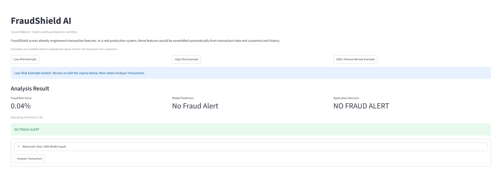
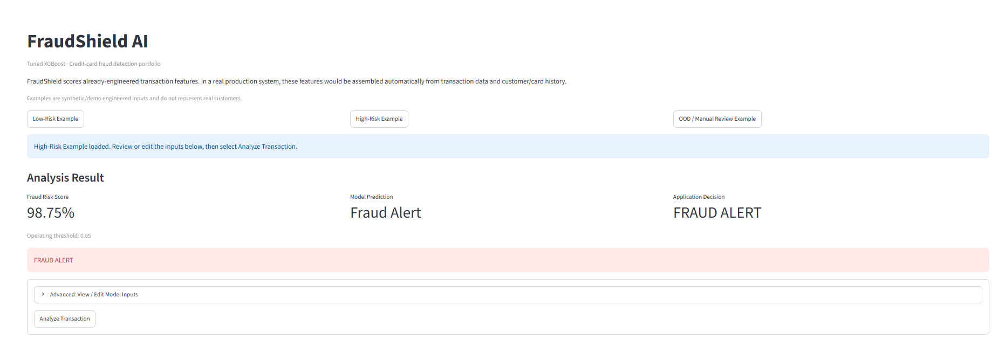
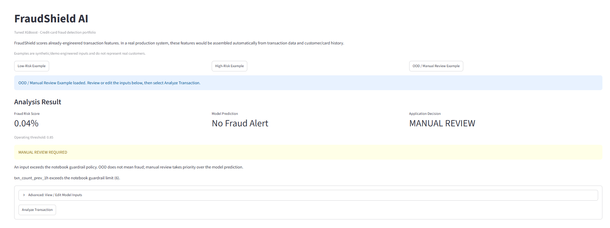
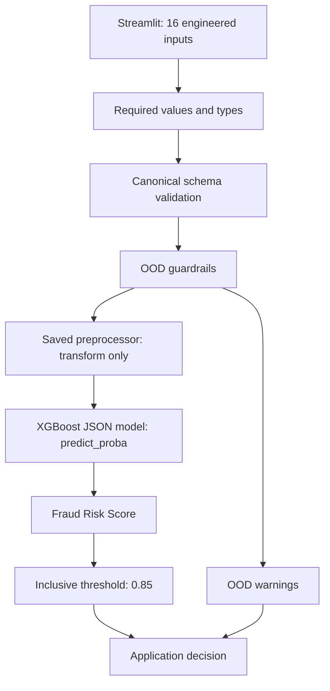

# FraudShield AI

FraudShield AI is a credit-card fraud detection portfolio project with a Streamlit
demo powered by tuned XGBoost, input validation, and manual-review guardrails.
It demonstrates ML engineering and AI/ML quality engineering, with the portable
production path reproducing the approved results across 555,719 test transactions.
The completed notebook remains the source of truth and is preserved unchanged.

[Demo](#demo) · [Approved metrics](#approved-test-baseline) ·
[Architecture](#architecture-and-guardrails) ·
[QA and regression](#aiml-qa-strategy-and-findings) ·
[Run locally](#installation-and-usage)

## Demo

The Streamlit interface demonstrates the real saved preprocessing and XGBoost
inference path using synthetic, already-engineered examples—not real customers.
In a real production system, the 16 features would be assembled automatically from
transaction data and customer/card history. This demo does not provide that history
infrastructure. Scores are **Fraud Risk Scores**, not guaranteed calibrated probabilities.

Select an example, review or edit the advanced inputs, then choose **Analyze Transaction**.

### Low-Risk Example

A low Fraud Risk Score (0.04% displayed) produces model prediction **No Fraud Alert**
and application decision **NO FRAUD ALERT**.



### High-Risk Example

The score (98.75% displayed) exceeds the **0.85** operating threshold. Model prediction
is **Fraud Alert** and application decision is **FRAUD ALERT**; this synthetic example
is not a confirmed fraudulent transaction.



### OOD / Manual Review Example

The model score remains low and its prediction is **No Fraud Alert**, but the
previous-hour transaction count exceeds the existing OOD guardrail of 6.
The application decision becomes **MANUAL REVIEW**. OOD does not automatically mean
fraud: the screenshot demonstrates why model prediction and application decision
are separate.



## Business problem

Identify fraudulent credit-card transactions while controlling missed fraud and
unnecessary alerts. Severe class imbalance makes accuracy alone misleading;
precision, recall, F1, ROC-AUC, and average precision guide evaluation.
The model produces a **Fraud Risk Score**, not a demonstrated perfectly calibrated
real-world probability. A low score does not guarantee legitimacy.

## Dataset and feature engineering

The notebook uses the Kaggle Credit Card Transactions Fraud Detection dataset:

| Split | Transactions | Period |
| --- | ---: | --- |
| Original training CSV | 1,296,675 | 2019-01-01 to 2020-06-21 |
| Untouched future test CSV | 555,719 | 2020-06-21 to 2020-12-31 |

The training dataset contains 983 cardholders. The target `is_fraud` is 0 for
legitimate transactions and 1 for fraud. The original training period is split
chronologically into 80% fitting data and 20% validation data. Raw Kaggle datasets
are not stored in this repository and must not be committed.

Notebook feature engineering includes transaction timing, age at transaction time,
Haversine distance, previous transaction timing, previous average spending, amount
relative to previous spending, previous-hour transaction count, and history flags.
Historical calculations must use only previously available transactions, without
target or temporal leakage. The application accepts already-engineered inputs; it does not
generate historical features or impute them.

## Models evaluated and final selection

The notebook evaluated Logistic Regression, Random Forest, baseline and tuned
XGBoost, a feedforward neural network, an LSTM with five-transaction sequences,
and a hybrid LSTM/XGBoost system. Tuned standalone XGBoost was selected for its
strongest final precision, F1, ROC-AUC, and PR-AUC, fewer false positives, and full
test coverage without the LSTM's sequence-availability requirement.

Selected parameters: 200 estimators, depth 8, learning rate 0.05, subsample 1.0,
column subsample 0.8, minimum child weight 1. Its saved sklearn Pipeline contains
fitted `OneHotEncoder(handle_unknown="ignore")`, numerical/binary passthrough,
and the fitted XGBoost classifier. Normal loading composes the exported fitted
preprocessor and the classifier loaded from XGBoost JSON without fitting or
duplicating preprocessing. It contains no raw feature engineering or
historical imputation. The Logistic Regression/FNN StandardScaler is not production
XGBoost preprocessing.

## Production input contract

The canonical ordered feature definition lives in `src/fraudshield/config.py`:

1. `amt`
2. `category`
3. `gender`
4. `state`
5. `city_pop`
6. `age`
7. `hour`
8. `day_of_week`
9. `month`
10. `is_weekend`
11. `cardholder_merchant_distance_km`
12. `time_since_prev_txn_min`
13. `customer_prev_avg_amt`
14. `amt_ratio_to_prev_avg`
15. `txn_count_prev_1h`
16. `no_prior_history`

`cc_num` may group historical records but is not a predictive input. `is_fraud`
must never be a model input. Reordered columns are accepted and normalized to the
canonical order; the final frame must contain exactly the expected named columns.
Required values cannot be missing, null, NaN, or blank. Numerical values must be
finite numbers; numeric strings are not silently coerced. Binary values are numeric
0 or 1. Other domain ranges and cross-field policies are not invented in this phase.
Unknown nonblank categorical values remain supported. The UI reads category choices
from the fitted encoder, avoiding the prototype's incomplete list.

## Approved test baseline

The production threshold is **0.85**. The inclusive rule `score >= threshold`
produces a fraud alert. Threshold selection used validation data before the final
evaluation on future test transactions.

| Metric | Approved notebook result |
| --- | ---: |
| Fraud precision | approximately 0.7122 |
| Fraud recall | approximately 0.8872 |
| Fraud F1 | approximately 0.7901 |
| ROC-AUC | approximately 0.9981 |
| PR-AUC (average precision) | approximately 0.9058 |
| Accuracy | approximately 99.82% |
| True negatives | 552,805 |
| False positives | 769 |
| False negatives | 242 |
| True positives | 1,903 |
| Model test coverage | 100% |

The portable production path reproduced this exact confusion matrix locally on all
555,719 approved engineered regression transactions. All five metrics match the
recorded four-decimal values. Investigate unexpected regression differences rather
than updating expected values. This baseline measures
the binary model at its threshold, not OOD manual-review routing performance.

## Architecture and guardrails



The preprocessor one-hot encodes categorical values and passes numerical/binary
features through without scaling. OOD warnings are retained while a score may still
be calculated. They take priority in the application decision: MANUAL REVIEW.
The UI displays the binary model prediction separately from the application decision.
Failed input validation or in-range inference produces an error, never an approval.
An entirely OOD batch can retain manual review with an unavailable score if inference
fails; mixed/in-range batches fail safely without fabricated scores or labels.

Existing notebook/application guardrails trigger strictly above:

| Feature | Limit |
| --- | ---: |
| `amt` | 28,948.90 |
| `txn_count_prev_1h` | 6 |
| `amt_ratio_to_prev_avg` | 676.39 |
| `time_since_prev_txn_min` | 22,357.85 |

These values were observed over the full original training CSV, not demonstrated
as exclusive estimator-fit ranges or statistically validated OOD thresholds. OOD
does not mean fraud. A score may still be calculated, but warnings cause the
application to return **MANUAL REVIEW**, overriding either binary decision.

## AI/ML QA strategy and findings

Independent PyTest tests exercise production functions: the canonical schema,
mandatory fields, NaN, numerical types, schema validation, OOD boundaries,
threshold boundaries, score validity, and artifact/configuration errors.
Mocks isolate software inference boundaries only; they are not trained models and
do not validate production accuracy. Real-artifact tests cover score generation,
unknown categories, reordered columns, reload consistency, and the controlled Colab
reference score. They skip explicitly when portable assets are unavailable;
incompatible supplied assets fail. The Colab fixture uses an explicit ratio of 1.333,
not a recomputed 100/75. Its score is checked against 0.0003787238 to the supplied
ten-decimal precision (absolute tolerance 5e-11, no relative tolerance).

**197 passed, 0 failed, 0 skipped** in the verified local test suite, including full regression on the approved
555,719-row parquet with exact TN/FP/FN/TP assertions. The parquet is excluded from
Git. A fresh clone without that private/local dataset skips the
one full-regression test; portable-artifact tests run when the included artifacts
are available. This is not a claim that raw dataset identity or temporal separation
can be independently checked from the engineered parquet alone.

Notebook findings:

- An overwritten test DataFrame caused regression mismatch; restoring the original
  data reproduced the approved confusion matrix. Future full regression must verify
  dataset identity and train/test temporal separation.
- Missing columns and malformed numeric text were rejected by the saved pipeline,
  but NaN amount values were accepted. Application validation must reject them.
- Unknown categories and reordered columns were handled successfully.
- Reloads produced identical scores; the inclusive threshold boundary was correct.
- Extreme inputs may receive low scores, motivating manual-review guardrails.
- An individual fraud example scored below the threshold: a measured false negative,
  not automatically a software defect.

The preserved notebook contains an earlier training-timestamp assignment to `test_df`
corrected by reloading the test CSV, and a stale QA summary describing QA Test 3 as
pending despite its later corrected rerun. These are not final production behavior.

## Repository structure

```text
FraudShield-AI/
├── AGENTS.md
├── FraudShield_Final_Completed.ipynb
├── README.md
├── requirements.txt
├── pyproject.toml
├── .gitignore
├── app.py
├── src/fraudshield/
│   ├── __init__.py
│   ├── config.py
│   ├── validation.py
│   ├── model_loader.py
│   ├── guardrails.py
│   └── prediction.py
└── tests/
    ├── conftest.py
    ├── test_validation.py
    ├── test_guardrails.py
    ├── test_prediction.py
    ├── test_model_loading.py
    └── test_regression.py
```

`models/` contains the six reviewed portable artifacts and provenance JSON files.
The original combined `.pkl` and all datasets remain local and ignored.

## Installation and usage

Use Python 3.12 or later in an isolated environment (validated locally on 3.12.14).
The pinned NumPy and XGBoost releases require Python 3.12+:

```shell
python -m venv .venv
# Windows PowerShell
.venv\Scripts\Activate.ps1
python -m pip install -r requirements.txt
python -m pip install --no-deps -e .
python -m pytest
python -m streamlit run app.py
```

The six validated portable production artifacts are committed and tracked in Git.
A fresh clone uses the supplied
`fraudshield_preprocessor.joblib`, `fraudshield_xgboost_model.json`, and
`xgb_config.json`. The configuration retains its recorded model name and threshold.
The original `fraudshield_xgboost_final.pkl` is retained outside Git as the approved
local historical reference and is never loaded for normal inference. `feature_config.json`,
`fraudshield_metadata.json`, and `environment_config.json` retain their provenance.
No replacement model or configuration is generated. Paths resolve relative to the
repository source location, not the launch working directory. Only load trusted
joblib artifacts.

The recorded Colab export environment is Python 3.13.16, scikit-learn 1.6.1,
XGBoost 3.4.1, NumPy 2.1.3, pandas 2.2.3, and joblib 1.6.0. The project-local
environment uses matching sklearn/XGBoost/joblib versions but differs in Python,
NumPy, and pandas; integration checks validate the supplied portable artifacts here.
Requirements pin scikit-learn 1.6.1, XGBoost 3.4.1, and joblib 1.6.0 to match the
portable artifacts. NumPy 2.5.4, pandas 3.0.6, Streamlit 1.65.0, and PyTest 9.1.1
are pinned to the local environment that passed full regression and UI smoke checks,
not asserted to be the original Colab versions. No installed packages were changed
for packaging. These are direct-dependency pins, not a complete transitive lockfile.
Missing/incompatible artifacts produce a setup error without a raw user traceback,
retraining, or substitute predictions.

## Current limitations

Portable artifact scoring, reload consistency, unknown categories, column order,
and the controlled Colab reference are tested locally. Full test-set regression has
also reproduced the approved confusion matrix. This does not establish performance
on other datasets, calibration, or a live production deployment. Raw dataset
integrity/temporal checks still require separately supplied approved raw data.
Verified full-precision history medians are unavailable; no
`history_config.json` is fabricated. Cold-start implementations differ and need an
approved policy before raw historical reconstruction. Users provide every engineered
history input, including the ratio and history flag.

There is no customer-history store, API, continuous monitoring system, or claimed
production deployment. Explainability and deep-learning research remain in the
notebook. No training occurs during application startup or inference.
